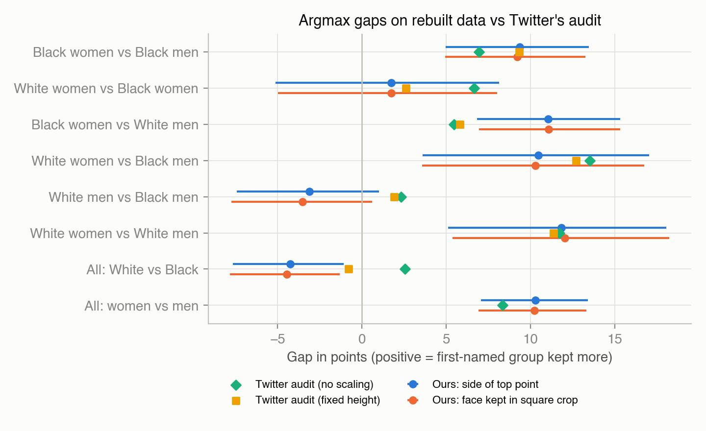
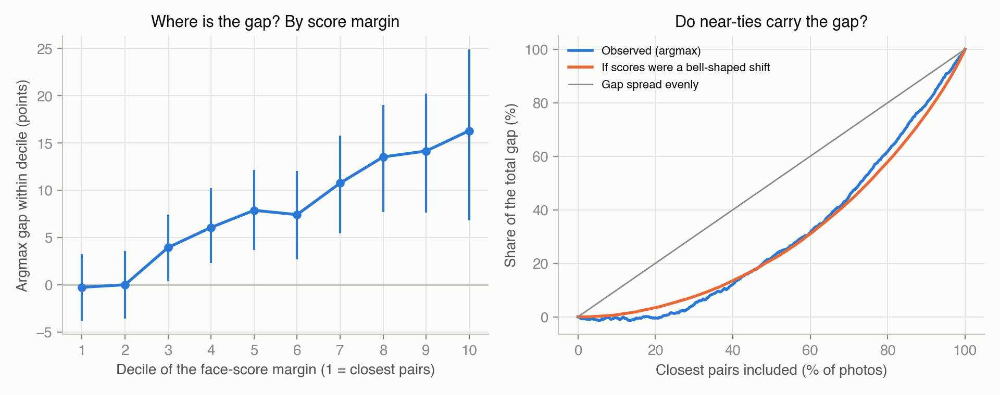
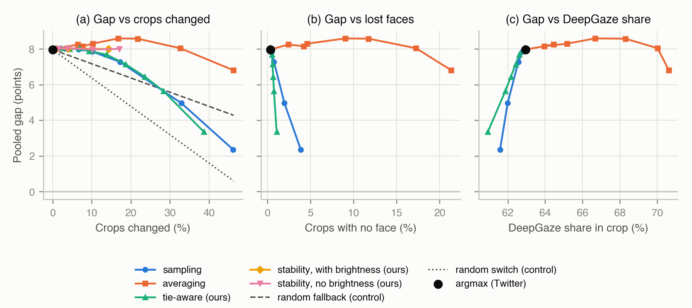
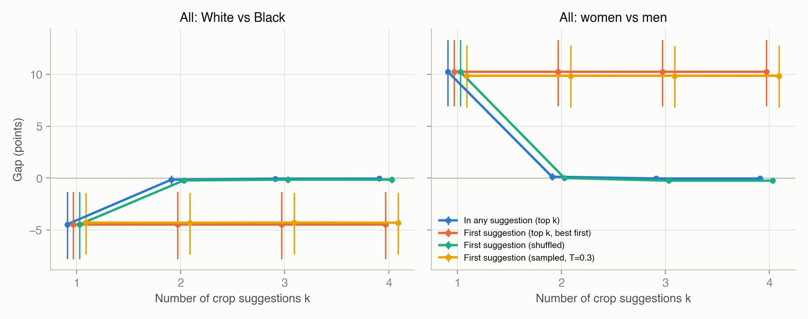

# reducing-twitter-image-crop-bias
testing crop rules that reduce race and gender bias in Twitter's saliency-based image cropping

Updated 2026-11-22

From 2018 to 2021 Twitter cropped photo previews around the single most salient point of a saliency map (argmax). Its audit found that the crops kept women more often than men and White people more often than Black people ([Yee et al., 2021](https://arxiv.org/abs/2105.08667)). This repo keeps Twitter's released saliency model fixed and tests decision rules that turn its map into a crop, so any change in the gaps comes from the rule alone.

## Rules compared

| Rule | How it picks the crop | Source |
|---|---|---|
| Argmax | Center on the highest-scoring grid point | Twitter's cropper |
| Sampling | Draw the center at random with weight exp(score / T) | Suggested in Twitter's audit |
| Averaging | Center on the mean position of the top n points | Suggested in Twitter's audit |
| Tie-aware | Crop candidates within eps of the best count as tied, pick one at random | Ours |
| Stability fallback | Show the full photo when the kept person changes on small edits of the photo | Ours |
| Random fallback | Show the full photo for a random share of photos | Control |
| k suggestions | Offer the k best distinct crops, in order, shuffled, or sampled | Suggested in Twitter's audit ("user choice among k points") |

## Results

Test split: 1,550 people (417 Black women, 571 Black men, 94 White women, 468 White men), 4,000 pairs per comparison, square crops. Intervals are 95% people-level bootstrap intervals.

**1. Twitter's gender gaps replicate, its race gaps do not.** Gap = how much more often the first-named group is kept, in points.

| Comparison | Argmax gap | 95% interval | Holm p | Twitter audit |
|---|---|---|---|---|
| Black women vs Black men | 9.2 | 4.9 to 13.3 | 0.006 | 7.0 |
| White women vs Black women | 1.7 | -4.3 to 7.3 | 0.55 | 6.6 |
| Black women vs White men | 11.1 | 6.9 to 15.3 | 0.006 | 5.5 |
| White women vs Black men | 10.3 | 4.1 to 16.1 | 0.009 | 13.5 |
| White men vs Black men | -3.5 | -6.6 to -0.5 | 0.056 | 2.3 |
| White women vs White men | 12.0 | 5.4 to 18.2 | 0.006 | 11.7 |
| All women vs all men | 10.2 | 6.9 to 13.3 | 0.001 | 8.4 |
| All White vs all Black | -4.5 | -7.3 to -1.8 | 0.003 | 2.5 |

Twitter audit values come from the raw counts it released for its main setting (no scaling, 10,000 pairs per comparison).

- Women are kept more often in all four pairings with men. Within each gender, the race gap is not significant.
- The overall White vs Black number mostly reflects who is in each group. Our White group is 83% men and our Black group 42% women, so the gender gap spills into it.
- Black-and-white photos (which the audit's recipe keeps) change the race results. With both photos in color, the race gaps point the same way as the audit's and come out close in size: White women vs Black women 6.5 (audit 6.6) and White men vs Black men 2.8 (audit 2.3). Neither is significant, and the overall White vs Black gap becomes 0.1. The gender gap stays at 11.3 (`results/replication.csv`).
- Pairs are not independent, because each person appears in many of them. Treating pairs as independent would give intervals of about ±1.5 points, two to four times too narrow. The audit's ±1.0% intervals made that assumption.



**2. Near-ties do not carry the gap.** The 10% of pairs with the closest face scores hold -0.3% of the gap (95% interval -4.4% to 3.2%), against 10% if the gap were spread evenly. The gap grows with the score margin and matches a plain shift in face scores. Women's faces score about 0.3 standard deviations higher. Argmax lands on a face in 94% to 98% of crops.



**3. Rules that act on near-ties barely change the gap.** Each rule below is at the setting that changes about 10% of argmax crops on validation pairs, chosen without labels. A random change of the same size removes the same share of the gap (random fallback) or twice that share (random switch to the other face).

| Rule | One-person crops changed | Gap removed (95% interval) | Crops with no face | Full photo shown |
|---|---|---|---|---|
| Argmax (Twitter) | 0% | 0% | 0.3% | 0% |
| Tie-aware (ours) | 9.3% | 1.0% (-5.0 to 5.7) | 0.4% | 0% |
| Stability fallback, no brightness (ours) | 10.1% | -0.1% (-6.3 to 5.5) | 0.2% | 10.4% |
| Sampling, T = 0.3 | 10.2% | 1.5% (-5.2 to 5.6) | 0.5% | 0% |
| Averaging, top 2 points | 7.7% | -2.3% (-8.1 to 1.7) | 4.2% | 0% |

- At every setting that changes at least 2% of one-person crops, every rule removes significantly less gap per changed crop than its random control (p ≤ 0.007, `results/square/efficiency.csv`). This is what a plain score shift predicts: crops change where the scores are close, and those pairs hold almost none of the gap.
- Large reductions need many random crops. Sampling at T = 1, the temperature in Twitter's own sampling code, removes 38% of the gap but changes 33% of one-person crops, and a rerun on the same photo changes who is kept 42% of the time.
- Tie-aware is cheap in quality and changes its choice less often than sampling at the same budget (9% vs 14% of reruns). Averaging centers between the two faces and loses faces.



**4. Two crop suggestions remove the coverage gap, the first suggestion keeps it.** With k = 2 both people appear in at least one suggestion for 97.6% of photos, and the coverage gap falls to 0.1 points (women vs men, -0.3 to 0.5). If the best suggestion is shown first, that first suggestion keeps the full 10.2-point gap. Shuffling the order removes it, at some cost to the first suggestion's quality.



**5. Checks.**
- Stability fallback shows the full photo equally often for every group, about 14% to 16% with any change. With or without brightness changes, Black and White people of the same gender fall back at rates within about one point of each other (`results/square/fallback_by_group.csv`).
- The face detector misses men's faces more often than women's (9% to 11% vs 3% to 4% of photos), with no race difference within gender (`results/face_detection_by_group.csv`).
- 3:4 crops give the same results (`results/portrait/`). Our crops match the crops printed by Twitter's program in 100% of composites.

## Data

Twitter released only the recipe for its WikiCeleb dataset, so we rebuild it with that recipe: people on Wikidata with a Library of Congress ID, a photo, male or female gender and an ethnic group, no photos dated before 1950, and Twitter's own map from 13 ethnic groups to race. The query ran on 2026-11-22, so counts differ from the audit's 2020 snapshot (`results/people_counts.csv`, `results/dataset_flow.csv`). Each photo is a 500 px or smaller Commons thumbnail with exactly one clear face (MTCNN). People are split 30% validation and 70% test within each group. The repo publishes counts and results only. Photos and per-person tables (Wikidata IDs with race and gender labels, splits and pairs) stay on the machine that ran the pipeline, in `data/` and `work/`.

## How it works

- **Composites.** Two photos, one per group, are scaled to 256 px height and placed side by side (Twitter's fixed-height setting). The group-1 person is on the left in exactly half of the pairs. Each test comparison has 4,000 pairs drawn so that every person appears about equally often.
- **Who is kept.** A person is kept when at least 90% of their face box width is inside the crop. The main crop is square, with 3:4 portrait crops as a check.
- **Gap.** Half the difference between how often only the group-1 person is kept and how often only the group-2 person is kept. It equals Twitter's "difference from demographic parity" when every crop keeps exactly one person.
- **Exact probabilities.** Random rules are scored by their exact chance of each outcome, so results need no random seeds.
- **Uncertainty.** Every interval comes from a two-way bootstrap over people ([Owen, 2007](https://doi.org/10.1214/07-AOAS122)) with 2,000 draws, because each person appears in many pairs. p-values are Holm-adjusted over the six comparisons.
- **Settings without labels.** Each rule's setting is picked on validation pairs, without demographic labels, as the setting that changes about 10% (or 20%) of argmax crops.
- **Near-tie test.** For each pair we take the highest saliency score inside each face box. We then ask whether the pairs with the closest face scores carry more of the gap than their share of photos, and compare with what a plain bell-shaped score shift would give.
- **Quality.** Crops that keep no face, faces cut by the crop edge, share of Twitter's own saliency inside the crop (which favors argmax by design), and share of [DeepGaze IIE](https://github.com/matthias-k/DeepGaze) fixation density inside the crop, an independent model, on 500 test composites per comparison.
- **Stability fallback** compares each composite with four changed copies. Two copies change brightness by 5%, one is mirrored and one is shifted 2% sideways. Because brightness may act differently on darker skin, a second version uses flips and shifts only, and fallback rates are reported by group.

## Run it

```bash
python3.10 -m venv .venv && .venv/bin/pip install -r requirements.txt
./scripts/get_twitter_model.sh
CROPBIAS_USER_AGENT="your-tool/0.1 (your contact URL or email)" CROPBIAS_DL_WORKERS=2 ./scripts/run_all.sh
```

Wikimedia asks automated downloads to name a contact and keep at most 2 requests in flight ([robot policy](https://wikitech.wikimedia.org/wiki/Robot_policy)). Every stage resumes where it stopped (`python -m cropbias <stage>`). The full run takes about 5 hours on a 4-core Intel Mac, mostly Twitter's program and DeepGaze. Unit tests: `.venv/bin/python -m pytest tests`.

## Layout

- `cropbias/` pipeline code: `wikidata.py`, `download.py`, `faces.py`, `design.py`, `composites.py`, `twitter_saliency.py`, `rules.py`, `evaluate.py`, `stats.py`, `analysis.py`
- `data/` (not in git) per-person tables: people, downloads, face boxes, splits and pairs
- `results/` tables (CSV) and figures, with per-rule results for each crop shape in `square/` and `portrait/`
- `work/` (not in git) photos, composites, saliency grids and per-composite results

## Limits

- Side-by-side composites are not natural group photos, and the audit's male-gaze question is out of scope.
- Race and gender come from Wikidata labels mapped with Twitter's census-based map. Such labels are coarse and can be wrong ([Scheuerman et al., 2020](https://doi.org/10.1145/3392866)).
- DeepGaze IIE is itself a gaze model, so its quality scores are a second opinion.
- Twitter's program and model are downloaded from [twitter-research/image-crop-analysis](https://github.com/twitter-research/image-crop-analysis) (Apache-2.0) and are not part of this repo.
